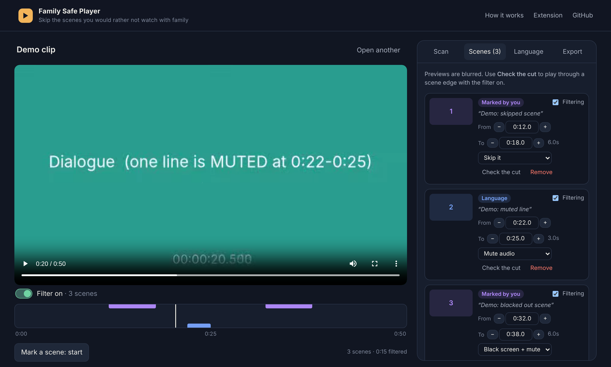
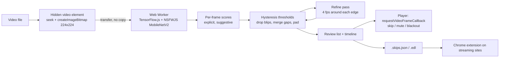

# Family Safe Player

Watch films with your family and skip the nudity and sex scenes. An image classifier scans the video **in your browser**, turns its frame scores into scenes, and plays the film with those scenes skipped, muted or blacked out. Subtitles can be used to mute swearing. A Chrome extension applies the same skip lists on Netflix, Prime Video, Disney+, Max and YouTube.

**Live demo:** https://phanisrikanth9.github.io/family-safe-player/ (nothing is uploaded; try the demo clip if you have no video handy)



## What it does

| Part | What you get |
|---|---|
| Scanner | Open an MP4/WebM file. Frames are classified on your GPU (WebGL) or CPU (WebAssembly) in a Web Worker. |
| Review | Every flagged scene with a blurred preview (hold to peek), confidence, editable start/end, and a "check the cut" button. Mark your own scenes too. |
| Strictness | Strict / Standard / Lenient. Switching re-detects instantly from the saved scores, no rescan. |
| Language filter | Load the `.srt` / `.vtt` subtitles and every line with profanity is muted. Whole-word matching, so *class* and *Scunthorpe* are safe. |
| Filtered player | Checks every rendered frame and jumps past a scene before its first frame shows. Skip, mute, or black screen + mute per scene. |
| Export | `.skips.json` for this player and the extension, or `.edl` that Kodi and MPlayer apply automatically. |
| Extension | Loads skip files per title, or mark scenes while you watch with **Alt+Shift+M**. Uses Netflix's internal player API for seeking, because Netflix rejects direct seeks. |

## How it works



**Design decisions worth explaining:**

- **Inference off the main thread.** The model runs in a Web Worker and frames are passed as transferable `ImageBitmap`s. Seeking frame *N+1* overlaps with classifying frame *N* (at most two frames in flight), so the GPU never waits for the decoder.
- **Hysteresis, not one threshold.** A scene opens when the score reaches `hi` and stays open until it drops below `lo`. One threshold makes a sex scene flicker in and out as the camera cuts to faces; hysteresis keeps it as one scene. Then: segments shorter than `minDuration` are dropped unless a frame is ≥ 0.9, scenes closer than `mergeGap` merge, and `pad` seconds are added on each side.
- **Two-pass scanning.** The first pass samples every 0.5–2 s. The second samples every 0.25 s only around detected edges, so boundaries are accurate to a quarter second while a 2-hour film costs roughly 1 extra frame per scene edge per 0.25 s instead of 4x the whole film.
- **Frame-accurate enforcement.** `timeupdate` fires only ~4 times a second, enough to flash a frame of the scene. The player uses `requestVideoFrameCallback` and looks 40 ms ahead.
- **Scores are kept, not just scenes.** Changing strictness re-runs detection over stored scores in milliseconds. Scores are saved in `localStorage` per file, so a film is only scanned once.
- **Backend fallback with measured gains.** WebGL → WebAssembly → plain JS. On a machine with no GPU, WebAssembly scanned a 40-frame test clip in 5.5 s versus 82 s for plain JS (about 15x).
- **Only what's needed ships.** NSFWJS bundles a 30 MB InceptionV3 model; importing from `nsfwjs/core` with explicit model definitions keeps it out of the build.

## Honest limits

- The classifier judges single frames. Implied scenes (a dark room, faces only) can be missed, and beach or gym scenes can be flagged. That is why every scene is reviewable, and why strictness is adjustable.
- Streaming services encrypt video (DRM), so a browser cannot read their frames. The extension therefore uses skip files: made here from your own copy of the film, shared by someone else, or marked by you during a solo preview.
- Skipping during private home playback is permitted in the US under the Family Movie Act of 2005. This tool never creates, stores or shares an edited copy of a film.

## Run it

```bash
cd web
npm install
npm run dev        # http://localhost:5173/family-safe-player/
npm test           # 25 unit tests: detection, refinement, playback, formats, subtitles
npm run build      # static site in web/dist
```

**Extension:** open `chrome://extensions`, turn on Developer mode, click *Load unpacked* and pick the `extension/` folder (or download `family-safe-extension.zip` from the live site).

## Project layout

| Path | What it is |
|---|---|
| `web/src/lib/segments.ts` | Scores → scenes: hysteresis, merging, padding, refinement times, skip targets (pure, tested) |
| `web/src/lib/scanner.ts` | Hidden-video frame grabber, pipelined with the worker |
| `web/src/worker/classify.worker.ts` | TensorFlow.js backend selection and NSFWJS inference |
| `web/src/lib/subtitles.ts` | SRT/VTT parser and profanity → mute segments |
| `web/src/lib/formats.ts` | Skip-file JSON (validated) and EDL export |
| `web/src/components/` | Player, timeline heat strip, scene review list |
| `extension/` | Manifest V3 extension: content script, Netflix main-world seek bridge, popup, options |
| `.github/workflows/pages.yml` | Test, build, package the extension, deploy to GitHub Pages |

Model: [NSFWJS](https://github.com/infinitered/nsfwjs) (MIT), MobileNetV2 trained on five classes: Drawing, Hentai, Neutral, Porn, Sexy.

Built by [Phani Srikanth Samayam](https://phanisrikanth9.github.io/Phani-Portfolio/).
